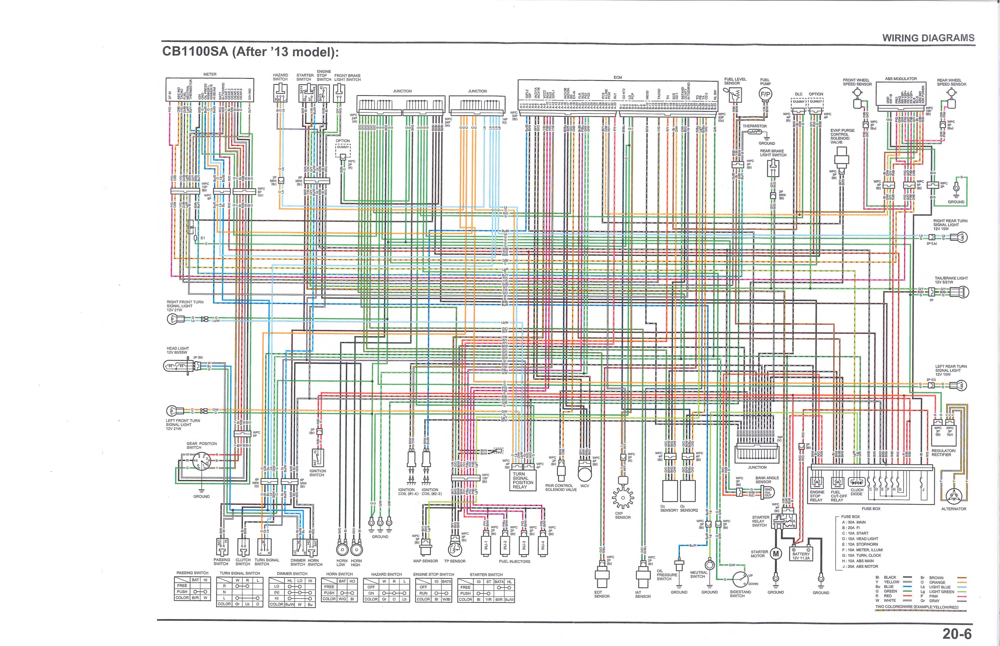
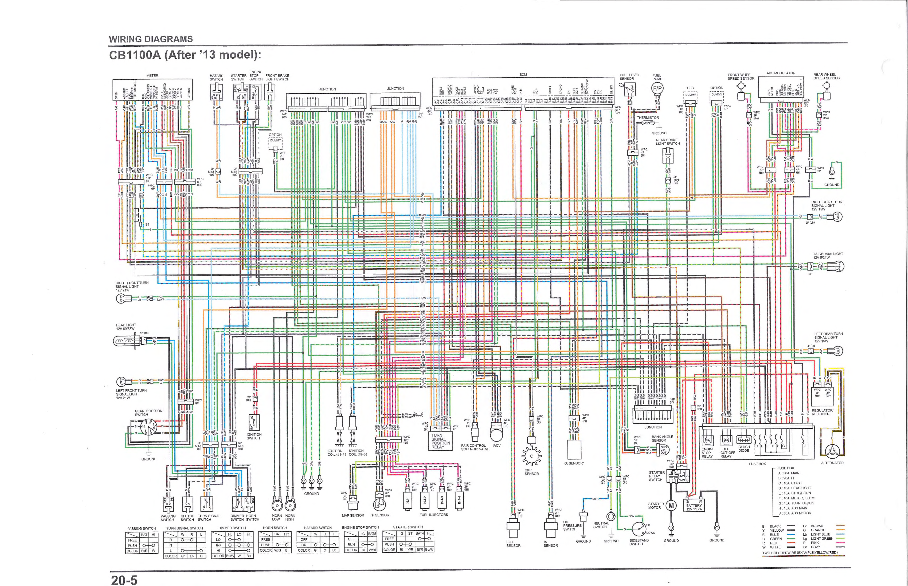

## Does the standard instrument cluster have an ABS indicator light?

No, probably not. Not only do the Speed/Tachs have different part numbers, let's cross-reference the schematics. Here is the ABS Model:
 

ffmpeg -I ABS.png -vf "negate,hue=h=180,eq=contrast=1.2:saturation=1.1" output.mp4

And the Non-ABS Model:

If you're anything like me, you're feeling like this right about now. 

The non-abs model receives the rear wheel speed sensor signal directly via 2 wires, whereas the rear (and front) speed sensors on the ABS model connect those wire to the ABS modulator. Then, the ABS modulator sends a single wire to the instrument cluster, from the PRO terminal to a “speed” terminal on the meter. It would appear that the ABS modulator is sending a binary data signal of some sort, or a varying voltage/current. Either way, the non-abs cluster is doing some sensor interpretation that is instead taken care of by the ABS modulator on the deluxe model.

## So the Instrument Clusters themselves need to be switched?

 In practice, it is possible that the rear speed sensor wire signals could simply be split between the standard meter and the added ABS modulator. The biggest concern is the ABS modulator potentially coding some kind of error because it expects a load on the PRO wire from the meter. This load could potentially be spoofed. The next concern is what to do about the ABS indicator light. Without a meter in front of me, it isn’t clear what it would take to simply stick an LED where it belongs gs on the cluster, and wire it directly to the modulator, but that may be possible.
